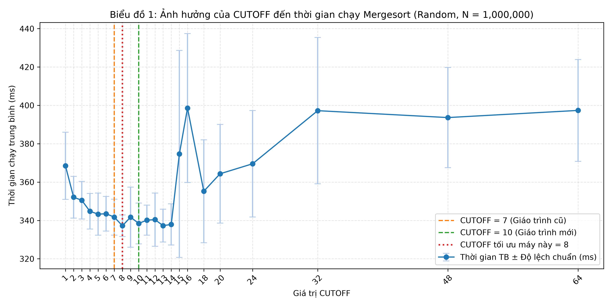
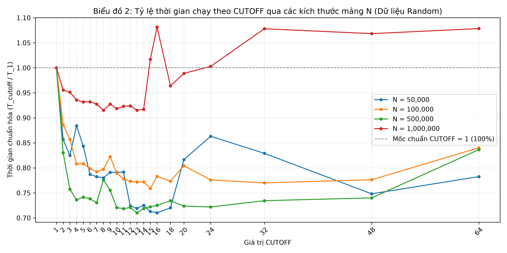
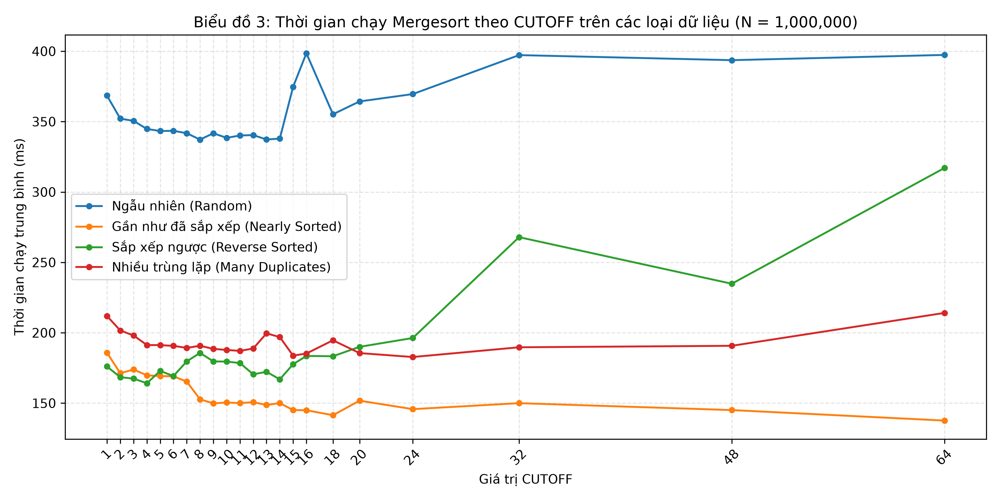

# Thực nghiệm tìm giá trị CUTOFF tối ưu cho Mergesort kết hợp Insertion Sort trong Java

## 1. Tóm tắt & Đặt vấn đề

Top-down Mergesort (Sedgewick & Wayne, *2.2 Mergesort*) có độ phức tạp $\Theta(N \log N)$, nhưng ở các mức đệ quy thấp nhất nó phải trả chi phí cố định rất lớn so với lượng công việc có ích: mỗi lời gọi đệ quy tạo một khung ngăn xếp mới, mỗi bước `merge` sao chép đoạn mảng sang `aux[]` rồi trộn ngược lại. Ngược lại, Insertion Sort có chi phí $\Theta(k^2)$ trên mảng con $k$ phần tử, nhưng với $k$ nhỏ thì hằng số rất thấp (vòng lặp ngắn, không đệ quy, không dùng `aux[]`, truy cập bộ nhớ cục bộ).

Thuật toán lai dùng ngưỡng `CUTOFF`: khi mảng con thoả `hi <= lo + CUTOFF - 1` (kích thước $\le$ `CUTOFF`), gọi `Insertion.sort(a, lo, hi)` thay vì đệ quy tiếp.

- `CUTOFF` quá nhỏ: số lời gọi đệ quy và số lần `merge` quá nhiều.
- `CUTOFF` quá lớn: chi phí $\Theta(k^2)$ của Insertion Sort chiếm ưu thế.

**Câu hỏi nghiên cứu:** trên cấu hình máy cá nhân này, `CUTOFF` tối ưu $k^*$ là bao nhiêu và nó khác thế nào so với `7` (giáo trình cũ) và `10` (giáo trình mới)? $k^*$ thay đổi ra sao theo $N$ và theo dạng phân phối dữ liệu?

## 2. Môi trường & Thiết kế thực nghiệm

### 2.1. Phần cứng và môi trường thực thi

| Thành phần | Thông số |
|---|---|
| CPU | AMD Ryzen 5 6600H with Radeon Graphics (6 nhân / 12 luồng; xung cơ bản 3,30 GHz; xung thực tế ghi nhận ~2,61 GHz) |
| Cache | L1: 384 KB \| L2: 3,0 MB \| L3: 16,0 MB |
| RAM | 16,0 GB DDR5, 4800 MT/s, chạy kênh đơn (1/2 khe SODIMM); khả dụng 15,3 GB (Total Physical Memory 15.677 MB) |
| Hệ điều hành | Microsoft Windows 11 Home Single Language (Version 10.0.26200, Build 26200); BIOS INSYDE Corp. V1.52 |
| Java | OpenJDK `25.0.4.1` LTS (Eclipse Temurin `25.0.4.1+1-LTS`, OpenJDK 64-Bit Server VM, mixed mode, sharing) |
| Cờ JVM | `-Xms2g -Xmx2g` (heap cố định) |

### 2.2. Cài đặt thuật toán

- `Merge.java`, `Insertion.java`: tự cài đặt bám sát bài giảng; dùng `Comparable[]`, mảng phụ `aux[]`, cắt sang `Insertion.sort(a, lo, hi)` khi `hi <= lo + CUTOFF - 1`.
- `CUTOFF = 1` tương đương Mergesort thuần (đoạn 1 phần tử là trường hợp cơ sở), dùng làm **baseline**.
- Hàm `isSorted()` kiểm tra tính đúng đắn của kết quả sau khi sắp xếp.

### 2.3. Bộ dữ liệu (`data/`)

Sinh cố định với `SEED = 42`:

- Kích thước: $N \in \{10\,000;\ 50\,000;\ 100\,000;\ 500\,000;\ 1\,000\,000\}$.
- 4 phân phối: `random` (ngẫu nhiên đều), `nearly_sorted` (gần có thứ tự, hoán đổi 1%), `reverse` (sắp xếp ngược), `duplicates` (nhiều trùng lặp, giá trị trong `0..9`).

### 2.4. Quy trình đo và kiểm soát nhiễu

- **Warm-up:** 15 lượt chạy làm nóng JIT trước khi bấm giờ.
- **Lặp:** `TRIALS = 25` lần cho mỗi tổ hợp `(data_type, n, cutoff)`, đo bằng `System.nanoTime()`.
- **Tách bước sao chép mảng** ra ngoài vùng bấm giờ (mỗi lần đo sắp xếp trên một bản sao mới của dữ liệu gốc).
- **Heap cố định** `-Xms2g -Xmx2g` để giảm nhiễu do thay đổi kích thước heap.
- **Thống kê:** trung bình $\mu$, độ lệch chuẩn $\sigma$, trung vị, giá trị nhỏ nhất, và

$$\text{Speedup}(k) = \frac{\mu_{1} - \mu_{k}}{\mu_{1}} \times 100\%$$

(dương: nhanh hơn `CUTOFF = 1`; âm: chậm hơn).

## 3. Kết quả thực nghiệm & Thống kê

### 3.1. Thống kê chi tiết: `random`, $N = 1\,000\,000$

Nguồn: `results/summary_random_1M.csv`. Đơn vị: ms.

| CUTOFF | Mean ($\mu$) | Std Dev ($\sigma$) | Median | Min | % Speedup |
|---:|---:|---:|---:|---:|---:|
| 1 | 368,47 | 17,49 | 361,54 | 354,23 | 0,00% |
| 2 | 352,11 | 10,90 | 348,96 | 343,60 | 4,44% |
| 3 | 350,53 | 9,79 | 347,71 | 343,56 | 4,87% |
| 4 | 344,79 | 9,25 | 342,61 | 337,47 | 6,43% |
| 5 | 343,30 | 10,98 | 340,79 | 336,43 | 6,83% |
| 6 | 343,48 | 9,07 | 340,33 | 335,02 | 6,78% |
| **7** (giáo trình cũ) | 341,74 | 9,38 | 339,10 | 335,20 | 7,25% |
| **8** ($k^*$) | **337,21** | **5,61** | 336,15 | 331,37 | **8,48%** |
| 9 | 341,72 | 15,67 | 337,23 | 329,76 | 7,26% |
| **10** (giáo trình mới) | 338,45 | 10,63 | 335,31 | 330,22 | 8,15% |
| 11 | 340,13 | 7,84 | 337,44 | 332,20 | 7,69% |
| 12 | 340,43 | 13,89 | 336,19 | 331,61 | 7,61% |
| 13 | 337,28 | 8,57 | 335,07 | 330,17 | 8,46% |
| 14 | 337,93 | 10,70 | 334,61 | 329,63 | 8,29% |
| 15 | 374,66 | 53,95 | 340,17 | 330,00 | -1,68% |
| 16 | 398,58 | 38,83 | 397,59 | 330,65 | -8,17% |
| 18 | 355,20 | 26,84 | 347,73 | 329,90 | 3,60% |
| 20 | 364,33 | 25,75 | 354,74 | 330,46 | 1,12% |
| 24 | 369,55 | 27,72 | 371,91 | 331,46 | -0,29% |
| 32 | 397,24 | 38,14 | 393,59 | 343,00 | -7,81% |
| 48 | 393,64 | 26,09 | 393,96 | 345,66 | -6,83% |
| 64 | 397,37 | 26,52 | 391,17 | 367,35 | -7,84% |

**Bảng đối chiếu bốn mốc yêu cầu** ($N = 10^6$, `random`):

| Mốc | $\mu$ (ms) | $\sigma$ (ms) | Median (ms) | Min (ms) | % Speedup so với `CUTOFF = 1` |
|---|---:|---:|---:|---:|---:|
| `CUTOFF = 1` (baseline) | 368,47 | 17,49 | 361,54 | 354,23 | 0,00% |
| `CUTOFF = 7` | 341,74 | 9,38 | 339,10 | 335,20 | 7,25% |
| `CUTOFF = 10` | 338,45 | 10,63 | 335,31 | 330,22 | 8,15% |
| `CUTOFF = k* = 8` | 337,21 | 5,61 | 336,15 | 331,37 | 8,48% |

### 3.2. `CUTOFF` tối ưu theo $N$ và dạng dữ liệu

Nguồn: `results/optimal_cutoffs_all.csv` (tối ưu xét theo thời gian trung bình nhỏ nhất, ms).

| Dạng dữ liệu | $N = 10^4$ | $N = 5\cdot10^4$ | $N = 10^5$ | $N = 5\cdot10^5$ | $N = 10^6$ |
|---|---:|---:|---:|---:|---:|
| `random` | 20 (1,571) | 16 (9,773) | 15 (21,429) | 13 (147,688) | **8** (337,214) |
| `nearly_sorted` | 48 (0,599) | 64 (3,999) | 64 (8,441) | 64 (62,657) | 64 (137,619) |
| `reverse` | 7 (0,823) | 11 (5,144) | 8 (10,900) | 7 (83,392) | 4 (164,111) |
| `duplicates` | 13 (1,074) | 13 (6,560) | 32 (13,322) | 15 (87,819) | 24 (182,768) |

*(Ô: `CUTOFF` tối ưu (thời gian trung bình nhỏ nhất, ms).)*

### 3.3. Biểu đồ



**Biểu đồ 1** (`random`, $N = 10^6$): thời gian giảm nhanh từ $\mu = 368{,}47$ ms ($k=1$) xuống $\approx 344$ ms ở $k=4$, sau đó tạo một **vùng phẳng** từ $k = 4$ đến $k = 14$ ($\mu \approx 337$–$344$ ms). Đáy đo được là $k=8$ ($337{,}21$ ms), sát với $k=13$ ($337{,}28$ ms) và $k=14$ ($337{,}93$ ms). Từ $k = 15$ thời gian tăng đột ngột, kèm độ lệch chuẩn lớn ($\sigma = 53{,}95$ ms tại $k=15$), đỉnh tại $k=16$ ($398{,}58$ ms), rồi dao động ở mức $355$–$370$ ms với $k = 18$–$24$ và tăng lên $\approx 394$–$397$ ms với $k \ge 32$.



**Biểu đồ 2** (`random`, thời gian chuẩn hoá $T_k/T_1$): với $N = 50\,000$; $100\,000$; $500\,000$ đường cong giảm mạnh ngay từ $k = 1 \to 3$ và đạt khoảng $0{,}71$–$0{,}76$ ở vùng tối ưu (tức nhanh hơn baseline khoảng 24–29%). Với $N = 10^6$, mức giảm khiêm tốn hơn (đáy $\approx 0{,}915$ tại $k=8$, khớp $337{,}21/368{,}47$) và đường cong vượt trên $1{,}0$ khi $k \ge 15$ (riêng $k=18$–$20$ còn dưới $1{,}0$). Ở $k = 64$ mọi đường đều quay lên (khoảng $0{,}78$–$0{,}84$ với $N \le 5\cdot10^5$, $\approx 1{,}08$ với $N = 10^6$). Các giá trị đọc từ biểu đồ là xấp xỉ.



**Biểu đồ 3** ($N = 10^6$, 4 phân phối): `random` có thời gian cao nhất ($\approx 340$–$400$ ms). `nearly_sorted` giảm gần như đơn điệu khi $k$ tăng (từ $\approx 186$ ms ở $k=1$ xuống $137{,}6$ ms ở $k=64$). `reverse` có đáy ở $k$ nhỏ rồi tăng mạnh khi $k \ge 24$ (đỉnh $\approx 317$ ms tại $k=64$). `duplicates` giảm nhẹ từ $\approx 212$ ms ở $k=1$ xuống khoảng $183$–$190$ ms ở $k = 15$–$32$, rồi tăng nhẹ khi $k = 64$.

## 4. Phân tích chuyên sâu & Thảo luận

### 4.1. Hình dạng đường cong chữ U

- **Vùng `CUTOFF` nhỏ ($k \le 4$):** số nút đệ quy và số lần `merge` (kèm sao chép sang `aux[]`) còn lớn. Chỉ riêng việc tăng $k$ từ 1 lên 4 đã giảm thời gian trung bình 6,43% ($368{,}47 \to 344{,}79$ ms).
- **Vùng đáy ($k \approx 4$–$14$):** lợi ích biên giảm dần, đường cong gần phẳng. Chênh lệch giữa các $k$ trong vùng này ($\approx 337$–$344$ ms) cùng cỡ với độ lệch chuẩn ($\sigma \approx 6$–$16$ ms), nên **không thể khẳng định một $k$ đơn lẻ vượt trội** nếu chỉ dựa vào trung bình.
- **Vùng `CUTOFF` lớn ($k \ge 32$):** chi phí $\Theta(k^2)$ của Insertion Sort trên mỗi khối vượt phần tiết kiệm được; thời gian tăng lên $\approx 394$–$397$ ms, tệ hơn baseline $\approx 7$–$8\%$.
- **Điểm bất thường tại $k=15,16$:** giá trị `min` tại $k=15$ ($330{,}00$ ms) và $k=16$ ($330{,}65$ ms) *ngang* các $k$ tốt nhất, nhưng $\mu$ và $\sigma$ tăng vọt (và median tại $k=16$ là $397{,}59$ ms). Nghĩa là các lần chạy nhanh vẫn đạt mức tối ưu, còn nhiều lần khác bị chậm hẳn. Dữ liệu hiện có không đủ để kết luận nguyên nhân; **giả thuyết** hợp lý là hành vi của JIT (quyết định biên dịch/inline khác nhau giữa các lần chạy trong cùng tiến trình) hoặc nhiễu hệ thống (GC, lập lịch Windows, nhiệt/xung nhịp trên laptop). Cần kiểm chứng bằng cách chạy lại theo thứ tự ngẫu nhiên, chạy nhiều tiến trình JVM riêng, hoặc bật `-Xlog:gc`/`-XX:+PrintCompilation`.

### 4.2. So sánh $k^*$ với mốc 7 và 10 của giáo trình

Trên $N = 10^6$, `random`: $k^* = 8$ ($\mu = 337{,}21$ ms, $\sigma = 5{,}61$ ms, độ lệch chuẩn nhỏ nhất vùng đáy).

| So sánh | Chênh lệch trung bình | Tương đương |
|---|---:|---|
| `7` → `8` | $341{,}74 - 337{,}21 = 4{,}53$ ms | nhanh hơn 1,33% |
| `10` → `8` | $338{,}45 - 337{,}21 = 1{,}24$ ms | nhanh hơn 0,37% |

Cả hai chênh lệch đều **nhỏ hơn độ lệch chuẩn** của từng cấu hình ($\sigma_7 = 9{,}38$; $\sigma_{10} = 10{,}63$ ms), nên về mặt thực hành các mốc `7`, `8`, `10` (và cả `13`, `14`) **không phân biệt được** với độ tin cậy cao. Kết luận quan trọng: giá trị `7` và `10` của giáo trình đều nằm **trong vùng tối ưu** của máy này; `10` nhỉnh hơn `7` (8,15% so với 7,25% speedup) nhưng khác biệt không có ý nghĩa thống kê rõ rệt. (Chưa chạy kiểm định thống kê, ví dụ Welch's t-test hay Mann–Whitney, nên chưa nêu p-value.)

Theo `min`, $k=14$ ($329{,}63$ ms) và $k=9$ ($329{,}76$ ms) đạt thấp nhất, nhưng `min` chỉ phản ánh lần chạy "may mắn" nhất và ít đại diện hơn $\mu$/median.

### 4.3. Giải thích dựa trên đặc thù phần cứng và JVM

*Lưu ý: các giải thích dưới đây là **giả thuyết cơ chế**; thí nghiệm này không đo trực tiếp cache miss, số nhánh sai dự đoán hay trạng thái JIT.*

- **Cache (L1 384 KB tổng cộng):** với 6 nhân, đây tương ứng khoảng 64 KB mỗi nhân (gồm L1D và L1I), nên L1D nhỏ hơn con số tổng gợi ý. Đoạn mảng con có $k \lesssim 14$ phần tử tham chiếu chỉ chiếm vài trăm byte, rất dễ nằm trong L1; điều này giúp Insertion Sort chạy hiệu quả ở $k$ nhỏ.
- **Bộ nhớ và `Integer[]`:** `Integer[]` lưu *tham chiếu*, còn các đối tượng `Integer` nằm rải rác trên heap. Mỗi `compareTo` phải dereference con trỏ, nên chi phí truy cập mỗi phần tử cao hơn mảng `int[]` và phụ thuộc vào vị trí cấp phát. Với $N = 10^6$, tập làm việc (mảng tham chiếu + `aux[]` + đối tượng `Integer`) vượt xa L2 (3,0 MB) và gần/vượt L3 (16 MB), nên các lần `merge` ở mức cao phải đọc từ RAM. Việc dùng RAM DDR5-4800 *kênh đơn* nhiều khả năng làm băng thông là điểm nghẽn, khiến việc **giảm số lượt `merge`/sao chép `aux[]`** (nhờ tăng `CUTOFF`) có lợi ích rõ rệt, phù hợp với mức giảm lớn ở $k$ nhỏ ở các $N \ge 5 \cdot 10^4$.
- **Bộ dự đoán nhánh hiện đại (Zen 3+):** vòng lặp trong Insertion Sort ngắn và có tính lặp, trên dữ liệu `random` nhánh so sánh vẫn khó dự đoán. Phần cứng hiện đại che bớt chi phí đệ quy/gọi hàm, nên lợi ích tương đối của `CUTOFF` (7–8%) *thấp hơn* kỳ vọng thường thấy ở các máy đời cũ; đây là giải thích khả dĩ cho việc đường cong phẳng rộng.
- **JIT của OpenJDK 25 (C2):** vòng lặp `Insertion.sort` nóng sẽ được inline/biên dịch tối ưu, giảm hằng số của nó, khiến Insertion Sort "rẻ" hơn lý thuyết và đẩy điểm hoà vốn lên cao hơn khi so với môi trường thông dịch. Quyết định inline phụ thuộc kích thước bytecode và hồ sơ chạy, có thể liên quan đến hiện tượng bất ổn tại $k = 15$–$16$ đã nêu ở 4.1 (giả thuyết, chưa kiểm chứng).
- **Hạn chế đo trên laptop Windows:** xung nhịp thực tế (~2,61 GHz) thấp hơn xung cơ bản, cộng với quản lý nhiệt/năng lượng và nhiễu từ OS, làm tăng $\sigma$ (đặc biệt $k \ge 15$ với $\sigma$ lên tới 54 ms).

### 4.4. Biến thiên của `CUTOFF` tối ưu theo $N$

- **`random`:** $k^*$ *giảm đơn điệu* theo $N$: 20 → 16 → 15 → 13 → 8 (khi $N$ tăng từ $10^4$ đến $10^6$). Có thể do $N$ lớn khiến chi phí truy cập bộ nhớ ở các mức `merge` cao chiếm tỷ trọng lớn hơn, đồng thời Insertion Sort trên khối lớn dễ gây cache miss tham chiếu `Integer`. Cần lưu ý đường cong ở vùng đáy rất phẳng nên $k^*$ riêng lẻ nhạy với nhiễu; xu hướng giảm nên được hiểu là *"vùng tối ưu dịch dần về trái"*, không phải một quy luật chính xác.
- **Với $N$ nhỏ** ($10^4$, `random`), $k^* = 20$ và thời gian ($1{,}57$ ms) rất ngắn nên dễ bị nhiễu tương đối lớn.

### 4.5. Biến thiên theo dạng phân phối

- **`nearly_sorted`:** $k^*$ nằm ở **biên trên của dải khảo sát** (48 với $N=10^4$, 64 với mọi $N \ge 5\cdot10^4$). Khi dữ liệu gần có thứ tự, Insertion Sort tiến gần $\Theta(k)$ thay vì $\Theta(k^2)$ nên $k$ càng lớn càng có lợi. Vì $k^*$ trùng biên 64, **giá trị tối ưu thật sự có thể lớn hơn 64** và chưa được xác định trong thí nghiệm này.
- **`reverse`:** $k^* = 7$–$11$ với $N \le 5 \cdot 10^5$, và $4$ với $N = 10^6$. Insertion Sort ở trường hợp xấu nhất $\Theta(k^2)$ nên $k$ lớn bị phạt nặng (Biểu đồ 3 cho thấy thời gian tăng mạnh khi $k \ge 24$). Đáng chú ý, $k^*=7$ và $k^*=8$ xuất hiện ở vài kích thước.
- **`duplicates`:** $k^* \in \{13, 13, 32, 15, 24\}$ — biến động rộng, không có xu hướng rõ theo $N$. Với chỉ 10 giá trị phân biệt, thời gian rất phẳng ở $k \approx 15$–$32$ (Biểu đồ 3), nên $k^*$ cụ thể dễ bị nhiễu quyết định.
- **`random`** là trường hợp có $k^*$ nhỏ-trung bình (8–20) và là dạng phản ánh tốt nhất hành vi trung bình.

## 5. Kết luận & Hướng dẫn tái lập thí nghiệm

### 5.1. Kết luận

1. Với `random`, $N = 10^6$, giá trị tối ưu đo được là **`CUTOFF` $k^* = 8$** ($\mu = 337{,}21$ ms, $\sigma = 5{,}61$ ms, nhanh hơn baseline **8,48%**).
2. Các mốc giáo trình `7` (7,25%) và `10` (8,15%) đều nằm trong vùng tối ưu; chênh lệch với $k^*$ lần lượt chỉ 1,33% và 0,37%, nhỏ hơn độ lệch chuẩn, nên **không khác biệt có ý nghĩa thực tiễn**.
3. Vùng an toàn trên máy này là **`CUTOFF` $\in [4, 14]$**; nên tránh $k \ge 15$ (thời gian và độ biến động tăng) và $k \ge 32$ (chậm hơn baseline).
4. **Khuyến nghị cho cấu hình này:** dùng `CUTOFF = 8` (hoặc `10` nếu muốn bám giáo trình mới) cho dữ liệu tổng quát/ngẫu nhiên. Với dữ liệu gần có thứ tự có thể dùng giá trị lớn hơn (≥ 64, cần khảo sát thêm); với dữ liệu sắp xếp ngược nên giữ nhỏ ($\approx 4$–$11$).
5. Hạn chế: kết quả thuộc một máy, một phiên bản JVM, một `SEED`; chưa có kiểm định thống kê; $k^*$ ở `nearly_sorted` chạm biên dải khảo sát.

### 5.2. Cấu trúc thư mục dự án

```
mergesort-cutoff-experiment/
├── src/
│   ├── Merge.java          # Top-down Mergesort + cắt sang Insertion Sort theo CUTOFF
│   ├── Insertion.java      # Insertion.sort(a, lo, hi) và isSorted()
│   ├── DataGenerator.java  # Sinh dữ liệu kiểm thử (SEED = 42) vào data/
│   ├── Benchmark.java      # Chương trình chính: warm-up, đo TRIALS lần, ghi CSV
│   └── analyze.py          # Đọc benchmark_raw.csv, tính thống kê, vẽ biểu đồ
├── data/                   # Dữ liệu kiểm thử (random, nearly_sorted, reverse, duplicates)
├── out/                    # Các file .class sau khi biên dịch
├── results/
│   ├── benchmark_raw.csv        # Kết quả thô của từng lần đo
│   ├── summary_random_1M.csv    # Thống kê random, N = 1.000.000
│   ├── optimal_cutoffs_all.csv  # CUTOFF tối ưu theo (data_type, N)
│   ├── chart1_u_curve_1M.png
│   ├── chart2_multi_n.png
│   └── chart3_data_types.png
├── .gitignore
└── README.md
```

### 5.3. Biên dịch và chạy lại

```bash
# 1. Biên dịch toàn bộ mã nguồn vào thư mục out/
javac -d out src/*.java

# 2. Sinh dữ liệu kiểm thử vào data/ (SEED = 42)
java -cp out DataGenerator

# 3. Chạy thực nghiệm (heap cố định), ghi kết quả thô vào results/
java -Xms2g -Xmx2g -cp out Benchmark

# 4. Tính thống kê và vẽ biểu đồ
python src/analyze.py
```

Thông số trong mã: `SEED = 42`, 15 lượt warm-up, `TRIALS = 25`, $N \in \{10^4; 5\cdot10^4; 10^5; 5\cdot10^5; 10^6\}$, `CUTOFF` $\in \{1,\dots,16,18,20,24,32,48,64\}$. Để giảm nhiễu: cắm sạc, chọn chế độ hiệu năng cao, đóng ứng dụng nền và chạy lại nhiều lần.
